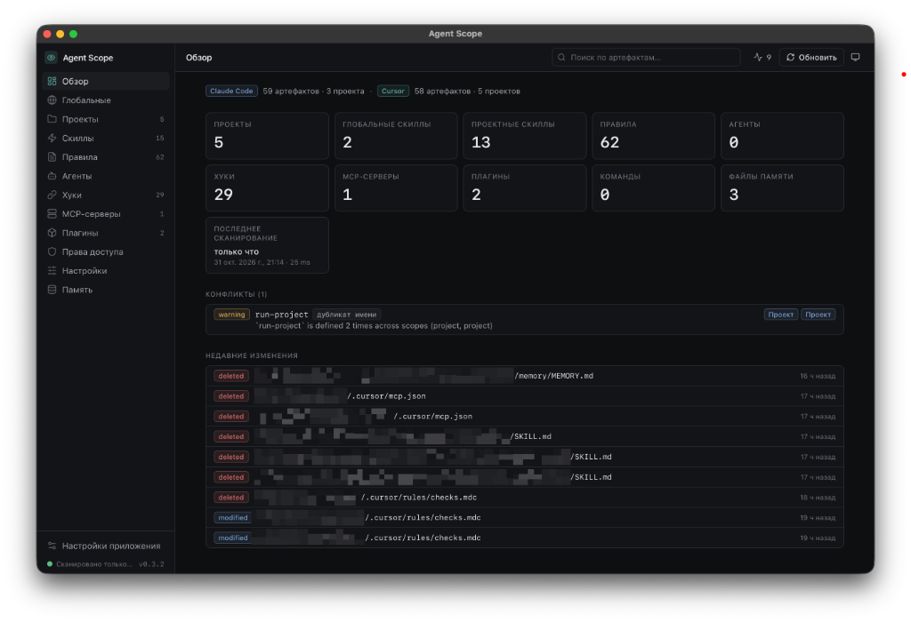

# Agent Scope

<p align="center">
  
</p>

<h3 align="center">All your AI tooling config — in one place.</h3>

<p align="center">
  A desktop app for viewing, analyzing, and managing configuration for AI development tools.
</p>

<p align="center">
  <a><b>English</b></a> ·
  <a href="docs/ru/README.md">Русский</a>
</p>

<p align="center">
  <a href="#install">Install</a> ·
  <a href="#features">Features</a> ·
  <a href="https://github.com/NejaTive/agent-scope/releases">Releases</a>
</p>

<p align="center">
  
</p>

---

## Why Agent Scope?

Claude Code, Cursor, and other AI tools rely on more and more config files: skills, rules, agents, hooks, MCP servers, plugins, and memory.

Some settings live in your home directory, others inside individual projects. Some override global defaults; others duplicate what you already have.

The more AI tools and projects you use, the harder it is to keep track of everything by hand.

**Agent Scope brings those configurations together in one UI.**

The app scans global and project settings, shows their structure, helps you find conflicts, and lets you safely edit supported files.

No more digging through dozens of hidden directories by hand.

## Install

### macOS

**Requirements:** macOS 11 (Big Sur) or newer · Apple Silicon

The easiest way to install Agent Scope is with Homebrew:

```bash
brew tap nejative/agent-scope
brew install --cask agent-scope
```

If Homebrew reports that the source is untrusted (`untrusted tap` or `untrusted cask`), run:

```bash
brew trust --cask nejative/agent-scope/agent-scope
```

Then install again:

```bash
brew install --cask agent-scope
```

You can also download a DMG from [GitHub Releases](https://github.com/NejaTive/agent-scope/releases).

**First launch:** if macOS shows a Gatekeeper warning, open the app via Right-click → **Open**.

### Windows

**Requirements:** Windows 10 or newer · x64 or ARM64 · WebView2 (usually preinstalled)

Download the NSIS installer for your CPU from [GitHub Releases](https://github.com/NejaTive/agent-scope/releases):

- `Agent.Scope_*_x64-setup.exe` — Intel/AMD 64-bit
- `Agent.Scope_*_aarch64-setup.exe` — ARM64 (Snapdragon / Copilot+ PCs)

Run the installer and launch **Agent Scope** from the Start menu.

### Linux

**Requirements:** x64 or ARM64 · WebKitGTK 4.1 (Debian/Ubuntu 22.04+, Fedora, and similar)

Download packages for your CPU from [GitHub Releases](https://github.com/NejaTive/agent-scope/releases):

| Format | Files | Notes |
| --- | --- | --- |
| AppImage | `Agent.Scope_*_x64.AppImage` / `*_aarch64.AppImage` | `chmod +x` then run |
| deb | `Agent.Scope_*_x64.deb` / `*_aarch64.deb` | Debian, Ubuntu, Mint |
| rpm | `Agent.Scope_*_x64.rpm` / `*_aarch64.rpm` | Fedora, RHEL, openSUSE |

Example (deb):

```bash
sudo apt install ./Agent.Scope_*_x64.deb
```

## Features

### Unified AI tooling overview

See how your AI environment is structured:

- Skills and rules.
- Agents and hooks.
- MCP servers and plugins.
- Memory and other supported artifacts.

Global and project settings are available in one place.

### Comfortable config browsing

Stop hopping between hidden directories and text editors.

- Browse Markdown and JSON files.
- Search for the configs you need.
- See where each artifact comes from.
- Compare global settings with per-project ones.

### Conflict and duplicate detection

Different AI tools and projects can share overlapping settings.

Agent Scope helps you spot:

- Duplicate artifact names.
- MCP configuration mismatches.
- Setting overrides.
- Potential inconsistencies between global and project configs.

### Change history

Keep an eye on how your AI environment evolves.

The change feed shows recently created, modified, and deleted files.

That makes it easy to see what changed after a tool update, a new plugin, or a project tweak.

### Editing under your control

Agent Scope is primarily for viewing configs, but sometimes you need a quick edit.

With editing enabled you can:

- Change the contents of supported settings.
- Rename existing settings within the same directory.
- Delete existing settings.

**Editing is off by default.**

### Local and secure

Agent Scope is a local desktop app.

- Config scanning runs locally.
- No AI service or cloud account is required.
- Secrets are masked when viewing files.
- Full contents are available only in explicitly enabled edit mode.
- The app does not execute configuration files.

## Supported tools

| Tool        | Support                         |
| ----------- | ------------------------------- |
| Claude Code | Global and project configs      |
| Cursor      | Global and project configs      |

**Upgrade** to the latest version:

- **macOS (Homebrew):**

```bash
brew upgrade --cask agent-scope
```

- **Windows / Linux / macOS (manual):** download the newest installer from [GitHub Releases](https://github.com/NejaTive/agent-scope/releases).

## Limitations

Agent Scope focuses on viewing and safely managing existing configurations.

It is not meant for:

- Creating new skills, agents, rules, and other artifacts from scratch.
- Running hooks, MCP servers, or shell commands from config files.
- Changing credentials or files outside the allowlist.
- Running on Intel Macs (Apple Silicon only on macOS).

## Tech stack

Agent Scope is built with a modern native stack:

- **Tauri 2** — lightweight desktop shell.
- **Rust** — scanning, config processing, and filesystem work.
- **Vue 3** — user interface.
- **TypeScript** — frontend typing.
- **Tailwind CSS** — UI styling.

## Development

Clone the repository and install dependencies:

```bash
npm install
```

Run the app in development mode:

```bash
npm run tauri:dev
```

Run Rust tests:

```bash
cd src-tauri
cargo test
```

Build the frontend:

```bash
npm run build
```

Build the desktop app (DMG / NSIS / AppImage+deb+rpm depending on host OS):

```bash
npm run tauri:build
```

Built installers and other artifacts are under:

```text
src-tauri/target/release/bundle/
```

On Linux, install WebKitGTK 4.1 and bundler deps first (Debian/Ubuntu example):

```bash
sudo apt install libwebkit2gtk-4.1-dev libappindicator3-dev librsvg2-dev patchelf rpm
```

Cross-target examples:

```bash
npm run tauri:build -- --target x86_64-pc-windows-msvc
npm run tauri:build -- --target aarch64-pc-windows-msvc
npm run tauri:build -- --target x86_64-unknown-linux-gnu --bundles appimage,deb,rpm
```

## Documentation

- [Claude Code spec](docs/spec/claude-code.md).
- [Cursor spec](docs/spec/cursor.md).

## License

[MIT](LICENSE) © Alexandr Sharov
