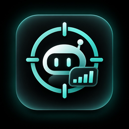
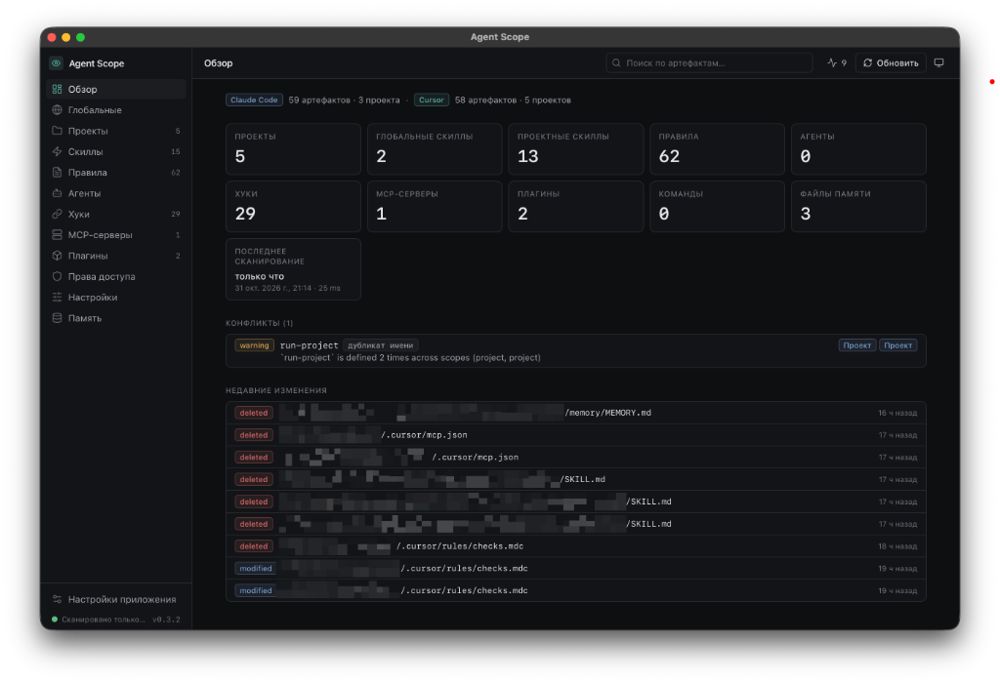

# Agent Scope

<p align="center">
  
</p>

<h3 align="center">Вся конфигурация AI-инструментов — в одном месте.</h3>

<p align="center">
  MacOS-приложение для просмотра, анализа и управления настройками AI-инструментов для разработки.
</p>

<p align="center">
  <a href="../../README.md">English</a> ·
  <a><b>Русский</b></a>
</p>

<p align="center">
  <a href="#установка">Установка</a> ·
  <a href="#возможности">Возможности</a> ·
  <a href="https://github.com/NejaTive/agent-scope/releases">Релизы</a>
</p>

<p align="center">
  
</p>

---

## Зачем нужен Agent Scope?

Claude Code, Cursor и другие AI-инструменты используют всё больше конфигурационных файлов: skills, rules, agents, hooks, MCP-серверы, плагины и memory.

Одни настройки хранятся в домашней директории, другие — внутри отдельных проектов. Одни переопределяют глобальные настройки, другие дублируют уже существующие конфигурации.

Чем больше AI-инструментов и проектов ты используешь, тем сложнее следить за всем этим вручную.

**Agent Scope собирает конфигурации в одном интерфейсе.**

Приложение сканирует глобальные и проектные настройки, показывает их структуру, помогает находить конфликты и позволяет безопасно редактировать поддерживаемые файлы.

Больше не нужно вручную искать конфиги по десяткам скрытых директорий.

## Установка

**Требования:** macOS 11 (Big Sur) или новее · Apple Silicon

Самый простой способ установить Agent Scope — через Homebrew:

```bash
brew tap nejative/agent-scope
brew install --cask agent-scope
```

Если Homebrew сообщает, что источник не является доверенным (`untrusted tap` или `untrusted cask`), выполни:

```bash
brew trust --cask nejative/agent-scope/agent-scope
```

После этого повтори установку:

```bash
brew install --cask agent-scope
```

## Возможности

### Единый обзор AI-инструментов

Посмотри, как устроена конфигурация твоего AI-окружения:

- Skills и rules.
- Agents и hooks.
- MCP-серверы и плагины.
- Memory и другие поддерживаемые артефакты.

Глобальные и проектные настройки доступны в одном месте.

### Удобный просмотр конфигураций

Забудь о необходимости постоянно переключаться между скрытыми директориями и текстовыми редакторами.

- Просматривай Markdown- и JSON-файлы.
- Ищи нужные конфигурации.
- Смотри, откуда взят каждый артефакт.
- Сравнивай глобальные настройки с настройками отдельных проектов.

### Поиск конфликтов и дублирований

Разные AI-инструменты и проекты могут использовать пересекающиеся настройки.

Agent Scope помогает обнаруживать:

- Дублирующиеся имена артефактов.
- Расхождения в конфигурациях MCP.
- Переопределения настроек.
- Потенциальные несоответствия между глобальными и проектными конфигурациями.

### История изменений

Следи за тем, как меняется твоё AI-окружение.

Лента изменений показывает недавно созданные, изменённые и удалённые файлы.

Это позволяет быстро понять, что изменилось после обновления инструмента, установки нового плагина или настройки проекта.

### Редактирование под твоим контролем

Agent Scope предназначен прежде всего для просмотра конфигураций, но иногда нужно быстро внести изменения.

При включении режима редактирования доступны:

- Изменение содержимого поддерживаемых настроек.
- Переименование существующих настроек в пределах той же директории.
- Удаление существующих настроек.

**Редактирование выключено по умолчанию.**

### Локальная работа и безопасность

Agent Scope — локальное приложение для macOS.

- Сканирование конфигураций выполняется локально.
- Не требуется подключение к AI-сервисам или облачным аккаунтам.
- Секреты маскируются при просмотре файлов.
- Полное содержимое доступно только в явно включённом режиме редактирования.
- Конфигурационные файлы не исполняются приложением.

## Поддерживаемые инструменты

| Инструмент     | Поддержка                           |
| -------------- | ----------------------------------- |
| Claude Code    | Глобальные и проектные конфигурации |
| Cursor         | Глобальные и проектные конфигурации |

**Обновление** до последней версии:

```bash
brew upgrade --cask agent-scope
```

Также можно скачать DMG непосредственно со страницы [GitHub Releases](https://github.com/NejaTive/agent-scope/releases).

**Первый запуск:** если macOS показывает предупреждение Gatekeeper, открой приложение через правый клик → **Открыть**.

## Ограничения

Agent Scope сосредоточен на просмотре и безопасном управлении существующими конфигурациями.

Приложение не предназначено для:

- Создания новых skills, agents, rules и других артефактов.
- Запуска hooks, MCP-серверов или shell-команд из конфигурационных файлов.
- Изменения credentials и файлов за пределами allowlist.
- Работы на Mac с процессорами Intel.

## Технологии

Agent Scope построен с использованием современного нативного стека:

- **Tauri 2** — лёгкая десктопная оболочка.
- **Rust** — сканирование, обработка конфигураций и работа с файловой системой.
- **Vue 3** — пользовательский интерфейс.
- **TypeScript** — типизация фронтенда.
- **Tailwind CSS** — стилизация интерфейса.

## Разработка

Клонируй репозиторий и установи зависимости:

```bash
npm install
```

Запуск приложения в режиме разработки:

```bash
npm run tauri:dev
```

Запуск Rust-тестов:

```bash
cd src-tauri
cargo test
```

Сборка фронтенда:

```bash
npm run build
```

Сборка macOS-приложения:

```bash
npm run tauri:build
```

Готовые DMG и другие артефакты сборки находятся в:

```text
src-tauri/target/release/bundle/
```

## Документация

- [Спецификация Claude Code](../spec/claude-code.md).
- [Спецификация Cursor](../spec/cursor.md).

## Лицензия

[MIT](../../LICENSE) © Alexandr Sharov